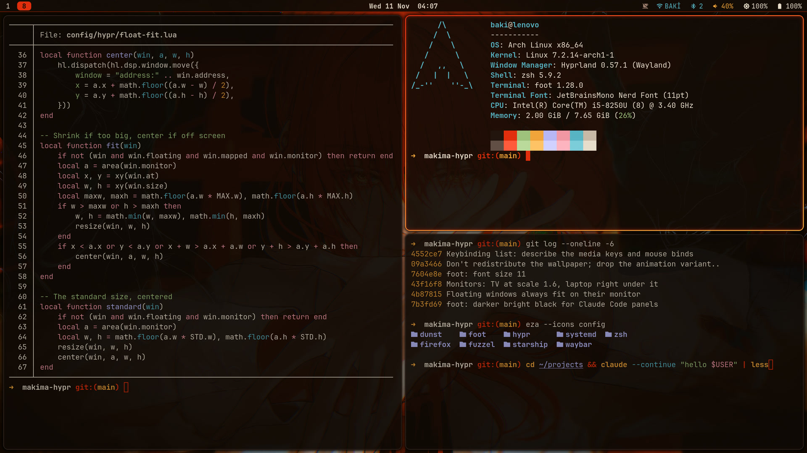
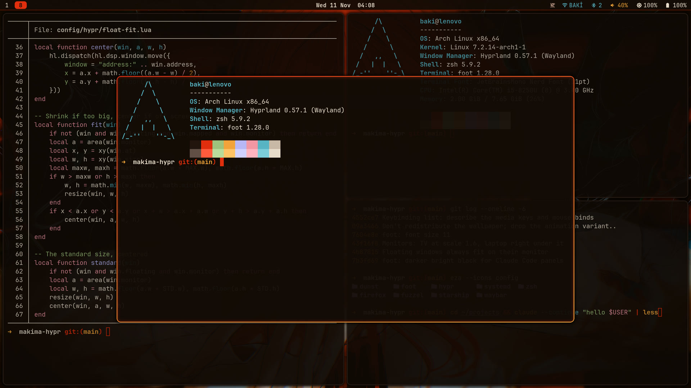
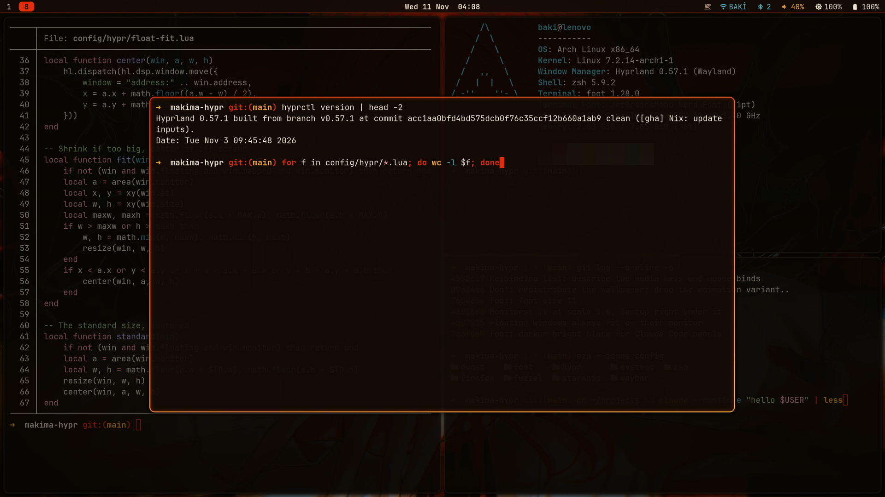
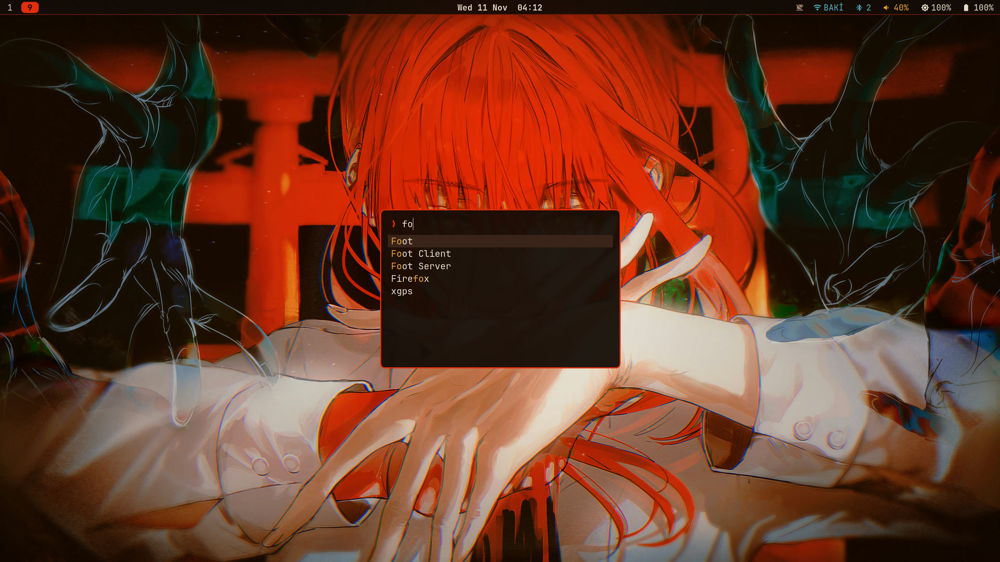
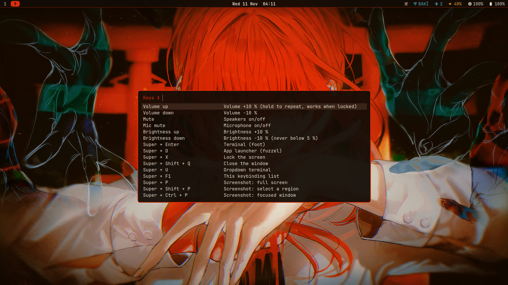
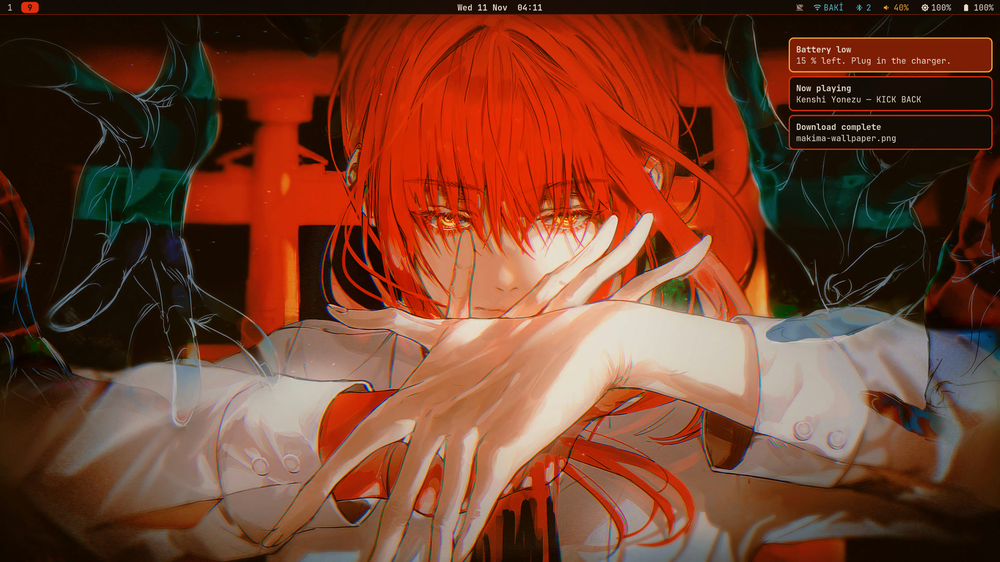
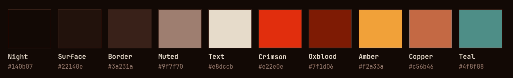
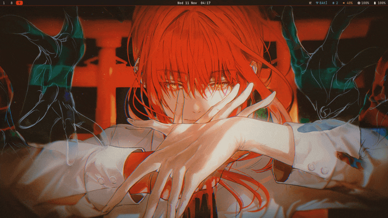
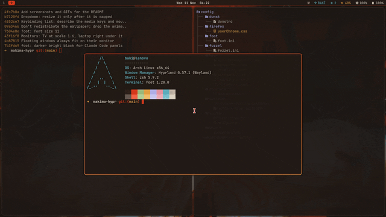
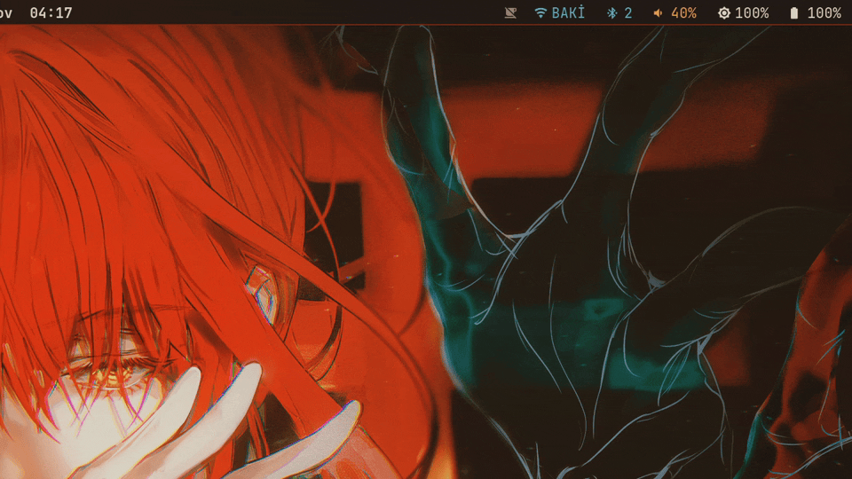

<div align="center">

# makima-hypr

**A hand-written Hyprland desktop themed after Makima from *Chainsaw Man*.**

Crimson hair, amber eyes, a torii gate at night.<br>
Every color on screen comes from one wallpaper.


[Screenshots](#screenshots) · [Motion](#motion) · [Palette](#color-palette) · [Install](#installation) · [Keybindings](#keybindings) · [Credits](#credits)

</div>

---

## About

This is my personal Hyprland setup, ported from my earlier Sway setup, [makima-sway](https://github.com/bakiakyol/makima-sway). The keybindings, colors, bar, menus and scripts carry over. What Hyprland adds is motion: windows pop in on a spring, workspaces slide, the dropdown terminal drops from the top, and a dragged window wobbles like jelly.

Nothing here comes from a theme pack or a dotfiles framework. Every file was written for this setup, and every number in it was measured on this machine:

| | |
|---|---|
| Machine | Lenovo laptop, Intel Core i5-8250U (4 cores, 8 threads), 8 GB RAM |
| GPU | Intel UHD Graphics 620 (the NVIDIA MX110 is left unused) |
| Screens | a 43" 2560×1440 TV at 1.6×, with the laptop's 1920×1080 at 1.5× centered below it |

The config is **Lua** (`hyprland.lua`). Hyprland 0.57 dropped the old `hyprland.conf` format, so most configs and snippets you find online won't load as they are. The reference is `/usr/share/hypr/stubs/hl.meta.lua` and the [Hyprland wiki](https://wiki.hypr.land). hyprlock, hypridle and hyprpaper still read the old `.conf` format.

---

## Screenshots

<table>
<tr>
<td width="50%"><br><sub><b>Desktop.</b> A thin bar and nothing else.</sub></td>
<td width="50%"><br><sub><b>Tiling.</b> Unfocused windows dim by 25 %, separately on each monitor.</sub></td>
</tr>
<tr>
<td><br><sub><b>Floating.</b> Always the same size and centered, never off screen.</sub></td>
<td><br><sub><b>Dropdown terminal</b> (<code>Super+U</code>) over a darkened workspace.</sub></td>
</tr>
<tr>
<td><br><sub><b>Launcher</b> (<code>Super+D</code>): fuzzel on blurred glass.</sub></td>
<td><br><sub><b>Keybinding list</b> (<code>Super+F1</code>), read live from Hyprland.</sub></td>
</tr>
<tr>
<td><br><sub><b>Notifications.</b> A critical one goes amber and stays on top.</sub></td>
<td><br><sub><b>Palette.</b> Sampled from the wallpaper, then tuned for contrast.</sub></td>
</tr>
</table>

---

## Motion

The animation set was designed with Claude Fable and measured with [`tools/anim-bench`](tools/anim-bench), a repeatable 30-second workload. Compared with Hyprland's stock set it uses **less CPU** (Hyprland went from 25 % to 21 % of one core during the run) while animating more things.

| | |
|---|---|
|  | **Windows** pop in on a spring that settles in about 0.28 s, with one small overshoot, and shrink away faster than they arrive. |
|  | **Wobble.** A dragged window bends like jelly and settles when you let go. This is the most expensive effect here, and the config says how to turn it off. |
|  | **Notifications** slide in from the right on the same blurred glass as the windows. |

Workspaces slide 12 % while they fade, so a switch has a direction. The dropdown terminal slides down from the top. The launcher pops in. A rotating border gradient was left out on purpose, because it would redraw the screen on every frame, forever.

---

## Components

| Role | Program | Config in this repo |
|---|---|---|
| Compositor | [Hyprland](https://hypr.land) 0.57 | `config/hypr/hyprland.lua` + two Lua modules |
| Bar | [Waybar](https://github.com/Alexays/Waybar) | `config/waybar/config.jsonc`, `style.css` |
| Terminal | [foot](https://codeberg.org/dnkl/foot) | `config/foot/foot.ini` |
| Shell prompt | [starship](https://starship.rs) + zsh colors | `config/starship/makima.toml`, `config/zsh/makima.zsh` |
| Launcher | [fuzzel](https://codeberg.org/dnkl/fuzzel) | `config/fuzzel/fuzzel.ini` |
| Notifications | [dunst](https://dunst-project.org) | `config/dunst/dunstrc` |
| Lock screen | [hyprlock](https://github.com/hyprwm/hyprlock) | `config/hypr/hyprlock.conf`, `bin/lock` |
| Idle | [hypridle](https://github.com/hyprwm/hypridle) | `config/hypr/hypridle.conf`: lock at 10 min, screens off at 11 |
| Wallpaper | [hyprpaper](https://github.com/hyprwm/hyprpaper) | `config/hypr/hyprpaper.conf`, built by `tools/make-wallpaper` |
| Firefox | tab strip in the palette | `config/firefox/userChrome.css` |
| Password prompts | hyprpolkitagent | started by `hyprland.lua` |
| Screen sharing | xdg-desktop-portal-hyprland | started on demand |
| Screenshots | grim + slurp + wl-clipboard | `bin/screenshot` |
| Wi-Fi | iwd (D-Bus) | `bin/wifi-menu` |
| Bluetooth | BlueZ (D-Bus + bluetoothctl) | `bin/bluetooth-menu` |
| Settings | GTK4 + libadwaita | `bin/settings`, saves to `config/hypr/settings.lua` |
| Cursor | Bibata Modern Amber, recolored crimson | `design/recolor-cursor.py` |
| Font | JetBrainsMono Nerd Font | – |

Two small Lua modules fix things Hyprland doesn't do by itself:

- **`dim-per-monitor.lua`** Hyprland dims every window except the focused one, so focusing the TV also darkened the laptop's window. This keeps the last focused window on each monitor bright, as if every monitor were its own screen.
- **`float-fit.lua`** The two screens have different sizes, so a floating window sized on one could hang off the other. Floating windows now get a standard size (66 % × 65 % of the screen), shrink if they are bigger than 90 %, and move back if any part is off screen.

---

## Color palette


**Main colors**, sampled from the wallpaper:

| | Name | Hex | Used for |
|---|---|---|---|
|  | Night | `#140b07` | backgrounds: bar, terminal, menus, notifications |
|  | Surface | `#22140e` | inactive borders and elements |
|  | Border | `#3a231a` | separators, selection background |
|  | Muted | `#9f7f70` | secondary text, the lock screen date |
|  | Text | `#e8dccb` | main text |
|  | **Crimson** | `#e22e0e` | **main accent**: focused window, active workspace, wrong password |
|  | Oxblood | `#7f1d06` | bar underline, critical notifications, the lock screen's password box |
|  | Amber | `#f2a33a` | second accent: the lock screen clock, progress bars, the prompt arrow |
|  | Copper | `#c56b46` | resize mode, Caps Lock, low battery |

**Harmonized colors.** Terminal programs and command-line highlighting need more colors than the wallpaper gives. These four were built in OKLCH around amber and crimson: the same perceived lightness, hues spread around the wheel, every pair at least 13 OKLab ΔE apart, and each above 8:1 contrast on Night.

| | Name | Hex | Used for |
|---|---|---|---|
|  | Teal | `#58b4c4` | Wi-Fi and Bluetooth in the bar, command options, terminal cyan |
|  | Sage | `#9fc17d` | strings, a charging battery, terminal green |
|  | Rose | `#f196a4` | variables, terminal magenta |
|  | Lavender | `#b7b6f6` | paths, terminal blue |

The whole story, including the terminal's 16 colors and the notification styles, is in [design/palette.md](design/palette.md).

---

## Requirements

Tested on **Arch Linux** with Hyprland 0.57.1, hyprlock 0.9.7, hypridle 0.1.8, hyprpaper 0.8.5 and Waybar 0.15.

```bash
sudo pacman -S --needed \
	hyprland hyprlock hypridle hyprpaper xdg-desktop-portal-hyprland xdg-desktop-portal-gtk hyprpolkitagent \
	waybar foot fuzzel dunst libnotify \
	grim slurp wl-clipboard xorg-xwayland \
	brightnessctl pipewire wireplumber iwd bluez bluez-utils \
	python python-gobject gtk4 libadwaita ffmpeg ttf-jetbrains-mono-nerd
```

For the shell part (optional): `zsh starship zsh-syntax-highlighting zsh-autosuggestions`.

`bluez` needs `sudo systemctl enable --now bluetooth`. The Wi-Fi module and menu expect **iwd**, not NetworkManager. Dark mode comes from the portal (`xdg-desktop-portal-gtk`, set up by `hyprland.lua`) for GTK4 apps and Firefox, and from `gtk-application-prefer-dark-theme=1` in `~/.config/gtk-3.0/settings.ini` for GTK3 apps. `python-gobject`, `gtk4` and `libadwaita` are only for the settings window. `ffmpeg` builds the wallpaper. `curl` and `xz` are needed only by `install.sh --cursor`.

### Things that are specific to my machine

| Setting | File | My value | Find yours with |
|---|---|---|---|
| Keyboard layout | `hyprland.lua` → `kb_layout` | `tr` (Turkish Q) | – |
| Monitors | `hyprland.lua` → `hl.monitor` | `HDMI-A-1` on top at 1.6×, `eDP-1` below at 1.5× | `hyprctl monitors` |
| Intel GPU | `bin/start-makima` → `intel_card` | PCI `0000:00:02.0` | `ls /dev/dri/by-path` |
| Wi-Fi interface | `waybar/config.jsonc` → `network.interface` | `wlan0` | `ip -br link` |
| Backlight | `waybar/config.jsonc` → `backlight.device` | `intel_backlight` | `ls /sys/class/backlight` |
| Battery / adapter | `waybar/config.jsonc` → `battery` | `BAT0` / `ADP0` | `ls /sys/class/power_supply` |

Any screen not named in `hyprland.lua` still works: a catch-all rule gives it its preferred mode and places it automatically.

---

## Installation

**1. Clone and link**

```bash
git clone https://github.com/bakiakyol/makima-hypr ~/projects/makima-hypr
cd ~/projects/makima-hypr
./install.sh -n          # dry run: shows what would change
./install.sh             # the real thing
./install.sh --cursor    # also build the crimson cursor (downloads Bibata, checks its hash)
```

**2. Get the wallpaper.** The artwork is not in this repo, because it belongs to its artist. Download it from [pixiv](https://www.pixiv.net/en/artworks/113984261) ("マキマ" by Hikaku), then build the two images the config expects:

```bash
tools/make-wallpaper ~/Downloads/113984261_p0.png
```

That writes `wallpapers/makima-torii.jpg` (2560×1440) and a blurred, darker copy for the lock screen. Any other image works too, though the palette was made for this one.

**3. Shell colors (optional).** Add this line at the **end** of `~/.zshrc`, after oh-my-zsh and the plugins:

```sh
[ -f ~/.config/makima-hypr/config/zsh/makima.zsh ] && . ~/.config/makima-hypr/config/zsh/makima.zsh
```

**What `install.sh` does.** It only makes symlinks:

- `~/.config/makima-hypr` → this repo. Every other link goes through this path, so if you move the repo, run `./install.sh` again and only this one link changes.
- `~/.config/hypr/{hyprland.lua, hyprlock.conf, hypridle.conf, hyprpaper.conf}`, `~/.config/foot/foot.ini`, `~/.config/fuzzel/fuzzel.ini`.
- Firefox's `chrome/userChrome.css`, plus the one pref that makes Firefox read it.
- `~/.local/bin/*` → `bin/`, and the battery warning timer.

A link left by makima-sway is replaced. Any other file already in the way is kept as `<name>.bak-makima-<date>`, never deleted. Waybar and dunst get no links: `hyprland.lua` starts them with this repo's files.

---

## Starting Hyprland

No display manager. Log in on a TTY and run:

```bash
start-makima
```

It picks the Intel GPU by its PCI address and runs `start-hyprland`, Hyprland's own launcher with a watchdog. To start it automatically when you log in on tty1, add this to `~/.zprofile` (or `~/.bash_profile`):

```sh
if [ -z "$WAYLAND_DISPLAY" ] && [ "$XDG_VTNR" = 1 ] && command -v start-hyprland >/dev/null; then
	exec start-makima
fi
```

---

## Keybindings

`Super+F1` shows all of them in a searchable list, read live from Hyprland, so it is never out of date.

<table>
<tr><td valign="top">

**Apps**

| Keys | Action |
|---|---|
| `Super+Enter` | Terminal |
| `Super+D` | App launcher |
| `Super+U` | Dropdown terminal |
| `Super+X` | Lock the screen |
| `Super+Shift+Q` | Close the window |
| `Super+P` | Screenshot: full screen |
| `Super+Shift+P` | Screenshot: region |
| `Super+Ctrl+P` | Screenshot: window |
| `Super+Alt+P` | Screenshot: after 3 s |

</td><td valign="top">

**Windows**

| Keys | Action |
|---|---|
| `Super+J K L Ş` / arrows | Focus |
| `Super+Shift+J K L Ş` / arrows | Move the window |
| `Super+F` | Fullscreen |
| `Super+Shift+Space` | Floating on / off |
| `Super+Space` | Floating ↔ tiled focus |
| `Super+E` | Split side by side / stacked |
| `Super+W` / `Super+Tab` | Tabs on / off, next tab |
| `Super+R` | Resize mode (`Enter` / `Esc` to leave) |
| `Super` + left / right drag | Move / resize |

</td></tr>
<tr><td valign="top">

**Workspaces**

| Keys | Action |
|---|---|
| `Super+1` … `0` | Workspace 1 … 10 |
| `Super+Shift+1` … `0` | Move the window there |
| Three-finger swipe | Next / previous workspace |

</td><td valign="top">

**Notifications and session**

| Keys | Action |
|---|---|
| `Super+N` | Close notifications |
| `Super+Shift+N` | Bring back the last one |
| `Super+Ctrl+N` | Do Not Disturb |
| `Super+Shift+C` | Reload the config |
| `Super+Shift+E` | Power menu |
| `Super+Ctrl+T` | Animation benchmark |

</td></tr>
</table>

Volume, mute, mic mute and brightness keys work too, also on the lock screen. `J K L Ş` is the home row of a Turkish Q keyboard; on a US layout it is `J K L ;`.

---

## Scripts

All in `bin/`, linked into `~/.local/bin`:

| Script | What it does |
|---|---|
| `start-makima` | Starts Hyprland from a TTY on the Intel GPU |
| `volume up\|down\|mute\|mic` | Volume through `wpctl`, with a popup that updates in place |
| `brightness up\|down` | Brightness through `brightnessctl`, with a popup |
| `lock` | hyprlock (never two at once) |
| `screenshot [select\|window\|delay]` | grim/slurp to `~/Pictures/Screenshots/` (or your XDG pictures folder) and the clipboard |
| `power-menu` | Lock / suspend / log out / reboot / shut down in fuzzel; the last three ask first |
| `keybindings` | The searchable keybinding list (`Super+F1`) |
| `dnd` | Do Not Disturb toggle (`dnd status` feeds the bar's bell) |
| `battery-warning` | Low battery popup at 15 % and 7 %, run every 2 minutes by a systemd user timer |
| `wifi-menu` | Wi-Fi networks from iwd in fuzzel: connect, disconnect, forget, enter a password |
| `settings` | A settings window (the gear at the right end of the bar): mouse, touchpad, keyboard, gaps, effects, volume, brightness |
| `bluetooth-menu` | Known Bluetooth devices in fuzzel: connect, disconnect, forget, or scan and pair a new one. A device whose pairing got lost is paired again on Connect |

And in `tools/`, not linked anywhere:

| Tool | What it does |
|---|---|
| `make-wallpaper` | Builds the wallpaper and the blurred lock screen copy from the original artwork |
| `anim-bench` | A repeatable 30 s animation workload that measures CPU and GPU use (`Super+Ctrl+T`) |

---

## Customization

**Settings window.** Click the gear on the bar or run `settings`. Changes apply at once and are saved to `config/hypr/settings.lua`, which `hyprland.lua` loads last. That file is git-ignored, and the undo button deletes it, so `hyprland.lua` always keeps the defaults.

**Save battery.** In `hyprland.lua`, set `wobble.enabled` to `false` first (it costs 3 to 4 times the CPU of having it off), then `blur` and `shadow`. Setting `animations = { enabled = false }` turns all motion off.

**Animations.** Each one is a single `hl.animation({...})` line in `hyprland.lua`, with comments. `speed` is in tenths of a second. To compare a change, run `Super+Ctrl+T` before and after; the results go to `~/.local/state/makima-hypr/bench.tsv`.

**Accent color.** The colors sit at the top of `hyprland.lua` (`local c = {...}`), `hyprlock.conf` (`$crimson`...), `waybar/style.css`, `dunstrc`, `foot.ini`, `fuzzel.ini` and `starship/makima.toml`.

**Command-line colors.** `makima.zsh` has three color sets. Put `MAKIMA_COLORS=tema` (wallpaper colors only) or `MAKIMA_COLORS=renkli` before the line that loads it; the default is the harmonized set.

**Check the config without restarting:**

```bash
Hyprland --verify-config -c ~/.config/hypr/hyprland.lua
```

---

## Troubleshooting

**Hyprland won't start or freezes:** switch to another TTY (`Ctrl+Alt+F2`, `F3`...), log in, and remove or comment out the `exec start-makima` line in `~/.zprofile`. Hyprland's log is in `$XDG_RUNTIME_DIR/hypr/<instance>/hyprland.log`.

| Symptom | Try |
|---|---|
| Red error bar at the top | `hyprctl configerrors` shows the bad line |
| A snippet from the internet doesn't work | It's probably `hyprland.conf` syntax. Since 0.57 only Lua loads; translate it with the wiki and `hl.meta.lua` |
| Black or gray background, blank lock screen | The wallpaper hasn't been built yet: see step 2 of [Installation](#installation) |
| No notifications, or they appear on another TTY's screen | Only one dunst can run per user. `hyprland.lua` replaces any running one when Hyprland starts; restart Hyprland or run `pkill dunst; dunst --config ~/.config/makima-hypr/config/dunst/dunstrc &` |
| A Bluetooth device is missing from the menu | It must be paired, trusted or connected. Otherwise use **Scan for new devices** |
| Screen sharing shows nothing | Check that `xdg-desktop-portal-hyprland` is installed, then log out and back in |
| Animations stutter | On Intel with TLP, raise `INTEL_GPU_MIN_FREQ_ON_AC`/`_ON_BAT` in `/etc/tlp.conf` a little (for example 300 → 500), as the [Hyprland wiki](https://wiki.hypr.land/Configuring/Advanced-and-Cool/Performance/) suggests |

---

## Repository layout

```
makima-hypr/
├── install.sh                   # symlinks everything into place
├── config/
│   ├── hypr/
│   │   ├── hyprland.lua         # compositor: keys, monitors, colors, animations, rules
│   │   ├── dim-per-monitor.lua  # one bright window per monitor
│   │   ├── float-fit.lua        # floating windows always fit on their monitor
│   │   ├── hyprlock.conf        # lock screen
│   │   ├── hypridle.conf        # lock at 10 min, screens off at 11, lock before suspend
│   │   └── hyprpaper.conf       # wallpaper
│   ├── waybar/                  # thin top bar (started by hyprland.lua)
│   ├── foot/ fuzzel/ dunst/     # terminal, launcher, notifications
│   ├── zsh/ starship/           # prompt and command-line colors
│   ├── firefox/userChrome.css   # tab strip in the palette
│   └── systemd/                 # battery warning timer
├── bin/                         # scripts (linked into ~/.local/bin)
├── tools/                       # make-wallpaper, anim-bench
├── wallpapers/                  # built by tools/make-wallpaper, not in git
├── design/                      # palette notes and swatches, cursor recolor script
└── assets/                      # README images
```

---

## Credits

The wallpaper is **「マキマ」 (Makima) by [Hikaku](https://www.pixiv.net/en/users/88393280)**, published on pixiv on 5 December 2023: <https://www.pixiv.net/en/artworks/113984261>. The artwork is not included in this repository; the screenshots show it as my desktop, with credit to the artist. All rights to the artwork belong to Hikaku. The whole color palette of this setup comes from this piece, so please go support the artist.

*If you are the artist and would like the screenshots changed or credited differently, please open an issue and I will act on it right away.*

**Makima** is a character from ***Chainsaw Man*** by **Tatsuki Fujimoto** (© Tatsuki Fujimoto / Shueisha, MAPPA). This is a non-commercial fan setup with no affiliation.

Built with [Hyprland](https://hypr.land) and its tools (hyprlock, hypridle, hyprpaper), [Waybar](https://github.com/Alexays/Waybar), [foot](https://codeberg.org/dnkl/foot) and [fuzzel](https://codeberg.org/dnkl/fuzzel) by dnkl, [dunst](https://dunst-project.org), [starship](https://starship.rs), [iwd](https://iwd.wiki.kernel.org), [Bibata Cursor](https://github.com/ful1e5/Bibata_Cursor) by ful1e5 (GPL-3.0; only the recolor script is in this repo), and [JetBrains Mono](https://www.jetbrains.com/lp/mono/) with [Nerd Fonts](https://www.nerdfonts.com) icons. The animation set was designed together with Claude.

---

## License

The configuration files and scripts are released under the [MIT License](LICENSE). The **wallpaper artwork is not covered** by this license and is not part of this repository; it belongs to its artist (see [Credits](#credits)). The Makima character belongs to her rights holders.
